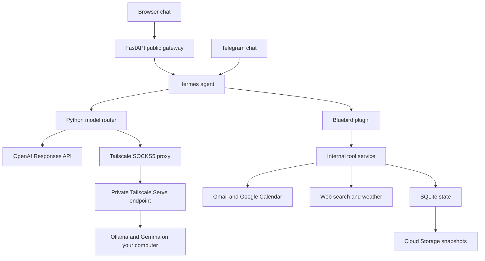
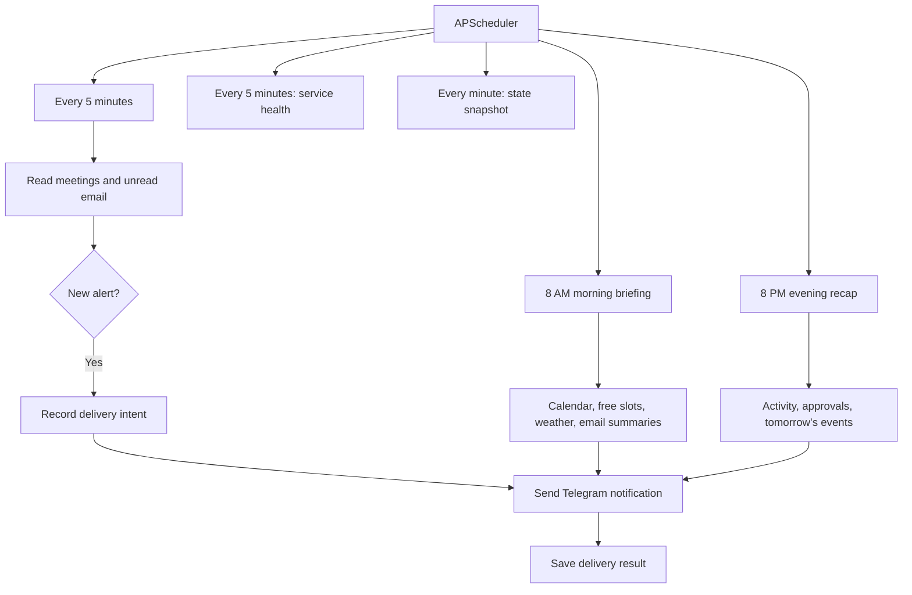

# Bluebird

Bluebird is a personal assistant built on Hermes. It connects email, calendar, web search, and weather to a Telegram bot and a browser chat. Scheduled jobs deliver morning briefings, evening recaps, and alerts for upcoming meetings and urgent email.

A Python router chooses between OpenAI and Gemma running locally through Ollama. Conversations marked private stay on the local inference path. Email sends require approval from the configured Telegram owner.

## Architecture



Hermes owns the conversation history and model/tool loop. The Bluebird plugin registers the tools and binds each request to its session. The router exposes an OpenAI-compatible endpoint so Hermes can use either provider through the same interface.

The public gateway listens on port 8080. Hermes and the tool/router service listen on loopback ports 8081 and 8090. The browser key and internal operator key are separate.

## What it does

- Reads email and calendar events, finds conflicts, and suggests available meeting windows.
- Searches the web through Hermes DDGS, with an OpenAI search fallback.
- Retrieves Los Angeles weather from Open-Meteo, with a National Weather Service fallback.
- Saves preferences when explicitly asked to remember them.
- Creates email drafts and requests approval in Telegram before sending.
- Restores preferences, approvals, job records, and delivery history after a restart.

The calendar gap finder is also available as a [standalone Hermes skill](https://github.com/vishnugamini/bluebird-calendar-skills).

## Model routing

Routing is implemented with Python rules. The router uses privacy state, request length, reasoning keywords, estimated context size, and provider availability.

| Request | Route |
|---|---|
| Private or confidential conversation | Gemma. Hold the request when local inference is unavailable. |
| Short request without reasoning keywords | Gemma when reachable and within its context budget, otherwise OpenAI |
| Reasoning, analysis, comparison, planning, or other ordinary request | OpenAI |
| Retryable cloud failure | Gemma when reachable and the request fits |
| Local generation failure in an ordinary conversation | OpenAI |

A simple request is at most 500 characters and has no reasoning keywords such as `explain`, `analyze`, `compare`, or `plan`. This is a heuristic, so phrasing affects routing.

Privacy persists through follow-ups in the same chat. Private sessions expose only preference memory and the local calendar-gap calculation. Messages still pass through the cloud Hermes gateway and the chosen chat platform.

The default models are `gpt-6-luna` and `gemma4:e2b-it-q4_K_M`. Ollama is configured for 65,536 context tokens, one parallel request, and one loaded model. Local output is capped at 1,024 tokens with thinking disabled. The router retries an availability check once after a transport error.

## Scheduled jobs



The alert check reads meetings starting within 30 minutes and urgent unread messages from the previous day. It marks email urgent when Gmail labels it important or the subject contains `urgent` or `action required`. Event occurrence IDs and message IDs prevent repeated notifications.

The heartbeat is a separate job. It records whether Hermes responds, Ollama is reachable, and an OpenAI key is configured. External API success is recorded through job outcomes.

Morning briefings combine calendar events, free slots, weather, and summaries of important unread email. Email summaries use the model router. Meeting alerts and evening recaps are built directly in Python and delivered through the Telegram Bot API.

Schedules use `America/Los_Angeles` by default. The Mac must be awake and connected for local inference.

## Requirements

- Python 3.14, Git, and [uv](https://docs.astral.sh/uv/)
- Hermes v0.22.7, installed by the included script
- Ollama with Gemma 4 support
- An OpenAI API key with access to the configured cloud model
- A Telegram bot and an owner direct chat
- A Google account and OAuth Desktop client for Gmail and Calendar
- Tailscale for cloud-to-local inference
- Google Cloud CLI with its beta component for Cloud Run deployment

## Local setup

Clone the repository and install the locked dependencies.

```sh
git clone https://github.com/vishnugamini/bluebird-assistant.git
cd bluebird-assistant
uv sync --locked
bash scripts/install-hermes.sh
uv run a3 init
```

The initializer creates an ignored `.env` and generates independent browser and internal keys. Fill in the remaining values using [.env.example](.env.example). The `a3` CLI name and `A3_` environment prefix are retained by the implementation.

### Ollama

Start the dedicated server in one terminal.

```sh
bash scripts/serve-gemma.sh
```

In another terminal, download the model.

```sh
OLLAMA_HOST=127.0.0.1:11435 ollama pull gemma4:e2b-it-q4_K_M
```

The script uses `.runtime/ollama-0.40.15/ollama` when present and otherwise uses the installed `ollama` executable. It binds to loopback port 11435. The model unloads after a short idle period, so later requests can include loading time. A 64K allocation needs sufficient system memory.

### Telegram

Create a bot through BotFather, set `TELEGRAM_BOT_TOKEN`, and send `/start` from the owner's direct chat. Retrieve the numeric IDs.

```sh
uv run a3 telegram-ids
```

Set `TELEGRAM_ALLOWED_USERS` and `TELEGRAM_HOME_CHANNEL` to the owner and chat IDs. Use a single active poller for the bot token.

### Gmail and Calendar

Enable Gmail and Calendar APIs in your Google Cloud project. Create a Google OAuth Desktop client and save it as `secrets/google-oauth-client.json`. Add your account as a test user when the OAuth app is in Testing.

Set `A3_TEST_EMAIL`, `A3_CALENDAR_ID`, and `A3_EMAIL_ALLOWLIST` in `.env`. Start with a dedicated mailbox as the sole allowed recipient.

```sh
uv run a3 google-login
```

The integration requests Gmail read/compose and Calendar event-read access. Google authorization is saved locally in the ignored credential file. Testing-mode refresh tokens can expire after seven days. A Production OAuth app can still display an unverified-app warning.

### Start Bluebird

With integrations configured and Ollama running, start the local service.

```sh
A3_SOCKS_PROXY= A3_OLLAMA_URL=http://127.0.0.1:11435 uv run a3 start
```

Open `http://127.0.0.1:8080`, enter `API_SERVER_KEY` from `.env`, and click Save. New chat starts a separate browser conversation. Telegram supports `/new`.

## Email approval

Sending follows a code-enforced approval flow.

1. Save a draft and read it back from Gmail.
2. Verify its preview fields and record a digest of the saved draft.
3. Show the recipient, subject, and complete body in Telegram.
4. Accept `/a3approve` or `/a3reject` from the configured owner within ten minutes.
5. Recheck the allowlist and draft digest before sending the reviewed message bytes.

Approvals are single use. Concurrent approvals cannot claim the same pending record twice. Changes to the saved draft invalidate the approval. Browser chat can save a draft and returns instructions to approve it through Telegram.

A timeout during Gmail or Telegram delivery can leave an uncertain outcome. Those records require review before retrying.

## Cloud deployment

The deployment script uses your environment settings.

```dotenv
GCP_PROJECT=your-project-id
GCP_REGION=us-west1
GCP_INSTANCE=bluebird
```

Authenticate Google Cloud CLI and provision the base resources.

```sh
gcloud auth login
uv run python scripts/deploy.py --prepare
```

For local inference from Cloud Run, connect the Mac through Tailscale and expose Ollama privately.

```sh
tailscale serve --bg http://127.0.0.1:11435
```

Set `A3_OLLAMA_URL` to the HTTPS `.ts.net` endpoint and `TAILSCALE_AUTHKEY` to the cloud node's enrollment key. Configure a tailnet grant that permits the cloud node to reach the Ollama endpoint.

Deploy after the integration credentials are configured.

```sh
uv run python scripts/deploy.py
```

The script creates the service account, private state bucket, Artifact Registry repository, and Secret Manager entries. Cloud Build produces a non-root container for a Cloud Run Instance. The default size is one vCPU and 1 GiB RAM. `--memory 2Gi` selects the larger memory option.

The container runs userspace Tailscale and explicitly proxies Ollama requests through SOCKS5. OpenAI requests use the cloud network directly.

## State and recovery

SQLite stores session privacy, preferences, pending approvals, delivery records, job history, and model-call metadata. Hermes keeps conversation history in its workspace.

The backup service uses SQLite's online backup API to create consistent copies. It uploads unique snapshot archives to Cloud Storage and updates a generation-checked manifest containing a SHA-256 digest. Startup verifies the archive before restoring state.

State is checkpointed before external sends. After a restart, interrupted sends and notifications become uncertain records, and unfinished jobs are marked interrupted. This supports recovery without automatically replaying ambiguous actions.

## API boundaries

| Endpoint | Purpose |
|---|---|
| `GET /` | Browser chat |
| `GET /privacy` | Privacy page template |
| `GET /health` | Hermes readiness |
| `POST /v1/chat/completions` | Authenticated browser request |
| `POST /ops/run` | Operator-only job execution |
| `POST /ops/simulate` | Operator-only rate-limit simulation |

Model routing, session binding, tools, and approval endpoints are served internally on loopback. Public chat requires the browser key, while operator endpoints use the separate internal key.

The browser accepts text messages and returns completed JSON responses. The provider adapters also support streaming at the internal model boundary.

## Development

Run application tests, the standalone skill tests, and the Hermes smoke check.

```sh
uv run pytest -q
uv run python -m unittest discover -s skill_tap/tests
uv run python tests/gateway_smoke.py
```

The tests cover routing and privacy, provider tool-call mappings, outage recovery, approval expiry and replay, draft mutation, memory isolation, alert deduplication, weather fallback, browser authentication, and snapshot restore.

Operators can run scheduled jobs manually against a deployment.

```sh
INSTANCE_URL="https://your-instance-url"
uv run a3 run-now briefing --url "$INSTANCE_URL"
uv run a3 run-now recap --url "$INSTANCE_URL"
```

A temporary 429 simulation tests cloud-to-local fallback. Enable it, send a reasoning request in a fresh ordinary chat, then disable it. The simulation also expires automatically after five minutes.

```sh
uv run a3 simulate-429 on --url "$INSTANCE_URL"
uv run a3 simulate-429 off --url "$INSTANCE_URL"
```

## Code map

| Path | Responsibility |
|---|---|
| `assistant/router.py` | Model selection, privacy, context limits, fallback |
| `assistant/providers.py` | OpenAI/Ollama adapters and streaming |
| `assistant/service.py` | Public and internal API boundaries |
| `assistant/runtime.py` | Process startup, Hermes configuration, Tailscale |
| `assistant/jobs.py` | Scheduler, briefings, alerts, weather, health |
| `assistant/google.py` | Gmail and Calendar API requests |
| `assistant/email.py` | Draft verification and approval state |
| `assistant/state.py` | SQLite transactions and preference scopes |
| `assistant/backup.py` | Snapshot creation and restore |
| `hermes/bluebird/` | Tools, session hook, Telegram approval commands |
| `skill_tap/` | Standalone calendar gap finder |
| `tests/` | Regression tests and smoke checks |

## Security and operating limits

Bluebird is designed for one owner. Credentials belong in `.env`, Secret Manager, or the restricted credential files. The repository includes empty placeholders.

Private routing governs model inference and tool access. The cloud gateway, Telegram, and stored conversation backups can still handle private messages.

The router estimates context size and classifies tasks with rules. It can misclassify task complexity. Polling intervals and bounded API result counts also affect which events and emails are seen in a check.

The calendar tool is read-only. Automatic jobs deliver information, and email sending requires the owner approval flow. External messages and search results remain untrusted input.

The included privacy page describes the default implementation. Set an appropriate support contact and adapt the page to your own deployment before using its URL in an OAuth consent screen.
